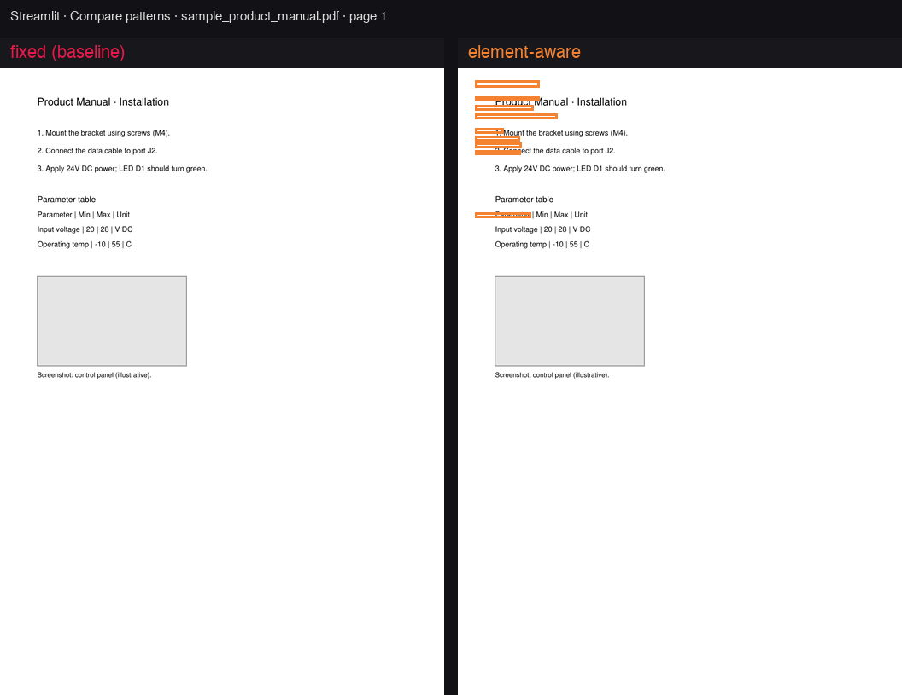
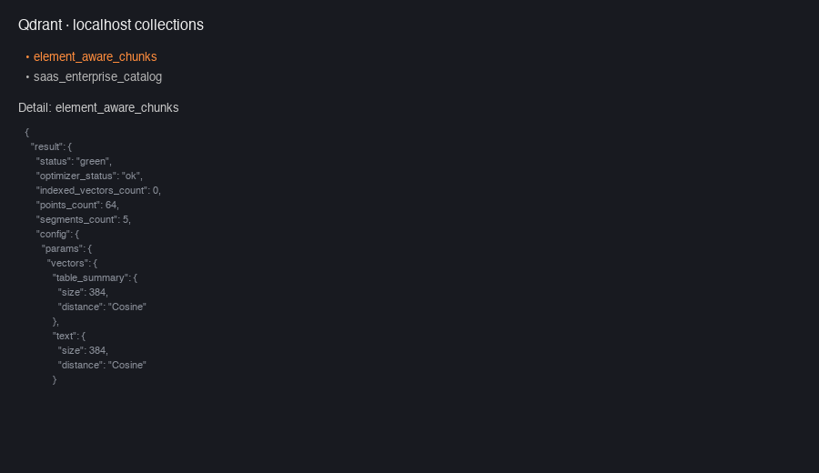
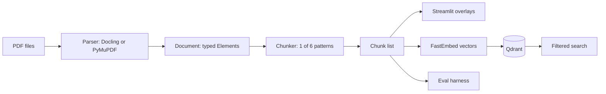

# element-aware-chunking

Element-aware chunking design patterns for RAG — text, tables & images → Qdrant, with visual diffs and a small eval.

> Design-pattern cookbook for mixed-content documents. Not another text-only chunking benchmark.


*Same page — `fixed` (no layout respect) vs `element` (bbox-aligned units). Regenerate: `make demo-gif`.*

### Screenshots (localhost)

**Streamlit — compare patterns** (`make ui` → http://localhost:8501):



**Qdrant — collections after ingest** (`make ingest`, default `element_aware_chunks` on `:6343`):



Regenerate images: `make screenshots` (Streamlit frame from sample PDF; Qdrant panel when the server is reachable).

## Why this repo

Most chunking examples focus on plain text. This project shows **six comparable patterns** on the **same PDFs**, with:

- Layout elements as first-class units (text, table, image)
- **Visual bbox overlays** per pattern (Streamlit)
- **Qdrant** named vectors + payload design ([docs/qdrant_payload_design.md](docs/qdrant_payload_design.md))
- Lightweight retrieval eval by **pattern** and **element type**

### Compared to prior art

| Project | Focus | Mixed content | Visual diff | Qdrant payload recipes |
|---------|--------|---------------|-------------|-------------------------|
| [adaptive-chunking](https://github.com/ekimetrics/adaptive-chunking) | Auto-select text chunker | No | No | No |
| [chunktuner](https://github.com/shantanu-deshmukh/chunktuner) | Tune chunk params | PDF structural only | No | No |
| [Multi-Modal-RAG](https://github.com/ankitanand3/Multi-Modal-RAG) | End-to-end multimodal app | Yes | No | Partial |
| **This repo** | Pattern catalog + teaching | Yes | **Yes** | **Yes** |

## Architecture

End-to-end flow: **PDF → parse into layout elements → chunk with a chosen pattern → (optional) embed and store in Qdrant → visualize or evaluate retrieval.**



### Parsing (layout → structured document)

Parsers turn each PDF into a **`Document`**: an ordered list of **`Element`** objects (text, table, image) with page number, optional **bounding box**, table markdown, and image paths. Chunking is **parser-agnostic** — every pattern runs on the same parsed output so comparisons are fair.

| Tool | Role |
|------|------|
| [Docling](https://github.com/docling-project/docling) (default) | Layout-aware extraction: typed blocks, reading order, boxes. Falls back to PyMuPDF if Docling is not installed. |
| [PyMuPDF](https://pymupdf.readthedocs.io/) | Lightweight path: text blocks, `find_tables()`, image extraction, page PNGs for the UI. Set `PARSER_BACKEND=pymupdf`. |

Entry point: `parse_document()` in `pipeline.py` — configured via `PARSER_BACKEND` in `.env`.

### Chunking (six patterns)

Each pattern is a small class under `src/element_aware_chunking/patterns/` that implements the same interface: `chunk(document) -> list[Chunk]`.

| Pattern | Algorithm (plain English) |
|---------|---------------------------|
| `fixed` | Fixed character windows with overlap on full document text (naive baseline). |
| `recursive` | Hierarchical text split: paragraphs → lines → sentences until under a size limit. |
| `page` | One chunk per page — all text on that page combined. |
| `element` | **One chunk per layout element**; tables and figures stay intact; metadata includes `bbox` and `element_type`. |
| `table_multirep` | Table-focused: short linearized summary for embedding + full table markdown in payload. |
| `hierarchical` | Smaller child chunks for retrieval linked to larger parent chunks for generation context. |

Entry point: `chunk_document(doc, pattern)`. Which pattern to pick: [DECISION.md](DECISION.md).

### Embeddings & vector store (optional)

| Tool | Role |
|------|------|
| [FastEmbed](https://github.com/qdrant/fastembed) | Local dense embeddings (default `BAAI/bge-small-en-v1.5`). |
| [Qdrant](https://qdrant.tech/) | Vector DB on `localhost:6343`; collection `element_aware_chunks`; named vectors `text` and `table_summary`. |

`make ingest` runs parse → chunk (all six patterns) → embed → upsert. Payload and index design: [docs/qdrant_payload_design.md](docs/qdrant_payload_design.md).

> **First model download:** FastEmbed needs to download `BAAI/bge-small-en-v1.5` before ingest or search. If Hugging Face returns `403`, create a read token at [Hugging Face settings](https://huggingface.co/settings/tokens), add `HF_TOKEN=hf_...` to `.env` (or run `huggingface-cli login`), then restart Streamlit. Keep the same embedding model after indexing: changing models requires recreating and re-ingesting the collection because vector spaces are not compatible.

### Demo & evaluation

| Component | Role |
|-----------|------|
| **Streamlit** (`make ui`) | Cached parse/chunk; side-by-side pattern compare; bbox overlays when metadata includes boxes. |
| **Eval** (`make eval`) | Hand-labeled Q&A over sample PDFs; embedding retrieval; Recall@3 / MRR by pattern and element type. |

Streamlit overlays and eval do **not** require Qdrant. The Streamlit **Qdrant search** panel and `make ingest` do.

## Patterns

| Pattern | Module | When to use |
|---------|--------|-------------|
| `fixed` | `patterns/fixed.py` | Baseline; exposes failure modes |
| `recursive` | `patterns/recursive.py` | Prose-heavy docs |
| `page` | `patterns/page.py` | Slides, dense visual pages |
| `element` | `patterns/element_aware.py` | **Default for mixed PDFs** |
| `table_multirep` | `patterns/table_multirep.py` | Table-heavy reports |
| `hierarchical` | `patterns/hierarchical.py` | Long sections; small children + parent context |

**Decision guide:** [DECISION.md](DECISION.md) — which pattern when, parser choice, Qdrant filters.

## Sample documents

`make download-samples` generates offline-safe PDFs under `data/raw/` and optionally fetches extra files from [data/raw/manifest.json](data/raw/manifest.json).

| Document | Category | Why included | Patterns that struggle | Patterns that excel |
|----------|----------|--------------|------------------------|---------------------|
| `sample_financial_report.pdf` | Financial-style | Dense table + footnotes | `fixed`, `recursive` | `table_multirep`, `element` |
| `sample_scientific_paper.pdf` | Scientific | Columns, figure, equation | `fixed`, `recursive` | `element`, `page`, `hierarchical` |
| `sample_product_manual.pdf` | Technical manual | Steps + parameter table + figure block | `fixed` | `element`, `hierarchical` |
| `sample_slide_deck.pdf` | Slide / visual layout | Large visual regions | `fixed`, `recursive` | `page`, `element` |

## Quick start

Full toolchain notes: **[docs/SETUP.md](docs/SETUP.md)**

```bash
make install              # python3 + pip, or uv if installed
make install-docling      # optional: richer Docling parser
cp .env.example .env
make samples
make verify               # tests + eval (+ Qdrant reachability when :6343 is up)
make ingest               # requires Qdrant — see below
python3 -m streamlit run app/streamlit_app.py   # http://localhost:8501
```

### See chunking on localhost

1. `make samples` (if `data/raw/` is empty).
2. `python3 -m streamlit run app/streamlit_app.py` from the repo root.
3. Open **http://localhost:8501**.
4. In the sidebar, choose **Compare patterns** → document **`sample_product_manual.pdf`** → page **1** → **fixed** vs **element**.
5. Watch **colored boxes** on the PDF (element-aware) vs no boxes (fixed) and read the **chunk text** lists under each panel.

Qdrant is not required for this UI; use **Qdrant search** only after `make ingest`.

```bash
make demo-gif     # README hero animation
make screenshots  # PNGs for README (Streamlit + Qdrant)
make eval
make test
```

Tests, eval, and Streamlit **overlays** work without Qdrant. **Ingest** and the Streamlit **Qdrant search** panel need a server on `QDRANT_HOST`:`QDRANT_PORT` (default `localhost:6343`).

## Qdrant (local)

This repo uses a **dedicated collection** — `element_aware_chunks` (set via `QDRANT_COLLECTION` in `.env`). It can live on the same Qdrant instance as other projects (e.g. an existing `saas_enterprise_catalog` collection); ingest only creates/updates `element_aware_chunks`.

### 1. Check if Qdrant is already running

```bash
curl -s http://localhost:6343/collections
```

If you get JSON with `"status":"ok"`, **skip `make qdrant`** and go to step 3 below.

### 2. Start Qdrant (only if curl fails)

**Option A — Docker** (needs `docker` on your PATH):

```bash
make qdrant   # docker compose -f ../rag-okf/docker-compose.yml up -d qdrant
```

Install [Docker Desktop](https://www.docker.com/products/docker-desktop/) if `docker: command not found`. Override the compose file with `QDRANT_COMPOSE_FILE` in `.env`.

**Option B — already running elsewhere**

If another stack (Docker, binary, cloud tunnel) already serves Qdrant on **6343**, align `.env` and use that — no `make qdrant` required.

### 3. Ingest chunks

```bash
make ingest
```

First run downloads the FastEmbed model; then each sample PDF is chunked with all six patterns and upserted to Qdrant.

Confirm the collection:

```bash
curl -s http://localhost:6343/collections/element_aware_chunks | python3 -m json.tool | head -20
```

### 4. Verify search

```bash
python3 -c "
from element_aware_chunking.qdrant_store import QdrantChunkStore
hits = QdrantChunkStore().search('revenue', limit=3, pattern='element')
print(len(hits), 'hits')
for h in hits:
    p = h.payload or {}
    print(round(h.score, 3), p.get('element_type'), (p.get('text') or '')[:60])
"
```

In Streamlit, open **Qdrant search** at the bottom of the page and query with the same pattern filter you used at ingest time.

Payload and named-vector layout: **[docs/qdrant_payload_design.md](docs/qdrant_payload_design.md)**.

## Project layout

```
src/element_aware_chunking/   # models, parsers, patterns, Qdrant, eval
app/streamlit_app.py            # visual diff + search demo
data/raw/                       # sample PDFs
data/eval/questions.json        # small QA set
docs/qdrant_payload_design.md
```

## Configuration

| Variable | Default |
|----------|---------|
| `PARSER_BACKEND` | `docling` (falls back to `pymupdf`) |
| `QDRANT_HOST` / `QDRANT_PORT` | `localhost` / `6343` |
| `QDRANT_COLLECTION` | `element_aware_chunks` |
| `QDRANT_URL` | optional override of host+port |
| `QDRANT_COMPOSE_FILE` | `../rag-okf/docker-compose.yml` (only for `make qdrant`) |
| `EMBEDDING_MODEL` | `BAAI/bge-small-en-v1.5` |

## GitHub

This project is a standalone git repo (`element-aware-chunking`). To publish:

```bash
brew install gh   # if needed
gh auth login
bash scripts/setup_github_remote.sh
```

Repository: [github.com/shunvel/element-aware-chunking](https://github.com/shunvel/element-aware-chunking)

Topics (from the plan) are applied from [.github/TOPICS.txt](.github/TOPICS.txt): `rag`, `chunking`, `qdrant`, `multimodal-rag`, `pdf`, `retrieval`, `vector-database`, `docling`, `streamlit`, `python`.

## License

MIT — see [LICENSE](LICENSE).
