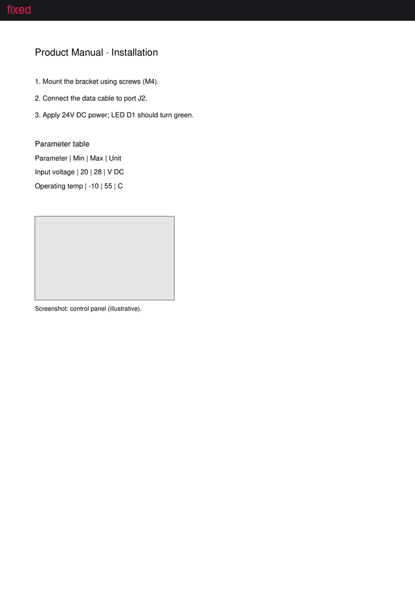

# element-aware-chunking

Element-aware chunking design patterns for RAG — text, tables & images → Qdrant, with visual diffs and a small eval.

> Design-pattern cookbook for mixed-content documents. Not another text-only chunking benchmark.



*Same page — `fixed` (no layout respect) vs `element` (bbox-aligned units). Regenerate: `make demo-gif`.*

## Why this repo

Most chunking examples focus on plain text. This project shows **six comparable patterns** on the **same PDFs**, with:

- Layout elements as first-class units (text, table, image)
- **Visual bbox overlays** per pattern (Streamlit)
- **Qdrant** named vectors + payload design ([docs/qdrant_payload_design.md](docs/qdrant_payload_design.md))
- Lightweight retrieval eval by **pattern** and **element type**

### Compared to prior art

| Project | Focus | Mixed content | Visual diff | Qdrant payload recipes |
|---------|--------|---------------|-------------|-------------------------|
| [adaptive-chunking](https://github.com/ekimetrics/adaptive-chunking) | Auto-select text chunker | No | No | No |
| [chunktuner](https://github.com/shantanu-deshmukh/chunktuner) | Tune chunk params | PDF structural only | No | No |
| [Multi-Modal-RAG](https://github.com/ankitanand3/Multi-Modal-RAG) | End-to-end multimodal app | Yes | No | Partial |
| **This repo** | Pattern catalog + teaching | Yes | **Yes** | **Yes** |

## Patterns

| Pattern | Module | When to use |
|---------|--------|-------------|
| `fixed` | `patterns/fixed.py` | Baseline; exposes failure modes |
| `recursive` | `patterns/recursive.py` | Prose-heavy docs |
| `page` | `patterns/page.py` | Slides, dense visual pages |
| `element` | `patterns/element_aware.py` | **Default for mixed PDFs** |
| `table_multirep` | `patterns/table_multirep.py` | Table-heavy reports |
| `hierarchical` | `patterns/hierarchical.py` | Long sections; small children + parent context |

**Decision guide:** [DECISION.md](DECISION.md) — which pattern when, parser choice, Qdrant filters.

## Sample documents

`make download-samples` generates offline-safe PDFs under `data/raw/` and optionally fetches extra files from [data/raw/manifest.json](data/raw/manifest.json).

| Document | Category | Why included | Patterns that struggle | Patterns that excel |
|----------|----------|--------------|------------------------|---------------------|
| `sample_financial_report.pdf` | Financial-style | Dense table + footnotes | `fixed`, `recursive` | `table_multirep`, `element` |
| `sample_scientific_paper.pdf` | Scientific | Columns, figure, equation | `fixed`, `recursive` | `element`, `page`, `hierarchical` |
| `sample_product_manual.pdf` | Technical manual | Steps + parameter table + figure block | `fixed` | `element`, `hierarchical` |
| `sample_slide_deck.pdf` | Slide / visual layout | Large visual regions | `fixed`, `recursive` | `page`, `element` |

## Quick start

Full toolchain notes: **[docs/SETUP.md](docs/SETUP.md)**

```bash
make install              # python3 + pip, or uv if installed
make install-docling      # optional: richer Docling parser
cp .env.example .env
make verify               # tests + eval (+ Qdrant check if Docker is up)
make qdrant               # Docker → rag-okf Qdrant on :6343
make ingest
python3 -m streamlit run app/streamlit_app.py
```

**Prerequisites:** [Docker Desktop](https://www.docker.com/products/docker-desktop/) for Qdrant (`make qdrant`). Without Docker you can still run tests, eval, and Streamlit overlays.

```bash
make samples      # offline PDFs in data/raw/
make demo-gif     # README hero animation
make eval
make test
```

## Project layout

```
src/element_aware_chunking/   # models, parsers, patterns, Qdrant, eval
app/streamlit_app.py            # visual diff + search demo
data/raw/                       # sample PDFs
data/eval/questions.json        # small QA set
docs/qdrant_payload_design.md
```

## Configuration

| Variable | Default |
|----------|---------|
| `PARSER_BACKEND` | `docling` (falls back to `pymupdf`) |
| `QDRANT_HOST` / `QDRANT_PORT` | `localhost` / `6343` (local Docker) |
| `QDRANT_URL` | optional override of host+port |
| `QDRANT_COMPOSE_FILE` | `../rag-okf/docker-compose.yml` for `make qdrant` |
| `EMBEDDING_MODEL` | `BAAI/bge-small-en-v1.5` |

## License

MIT — see [LICENSE](LICENSE).
